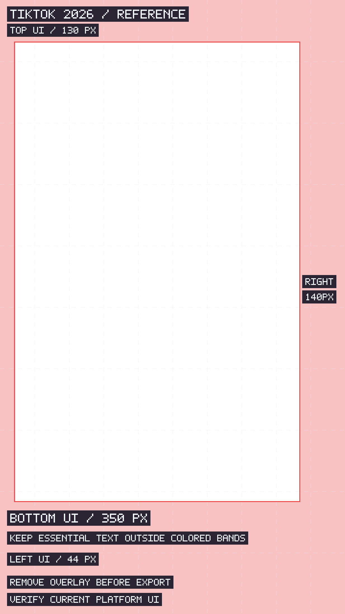
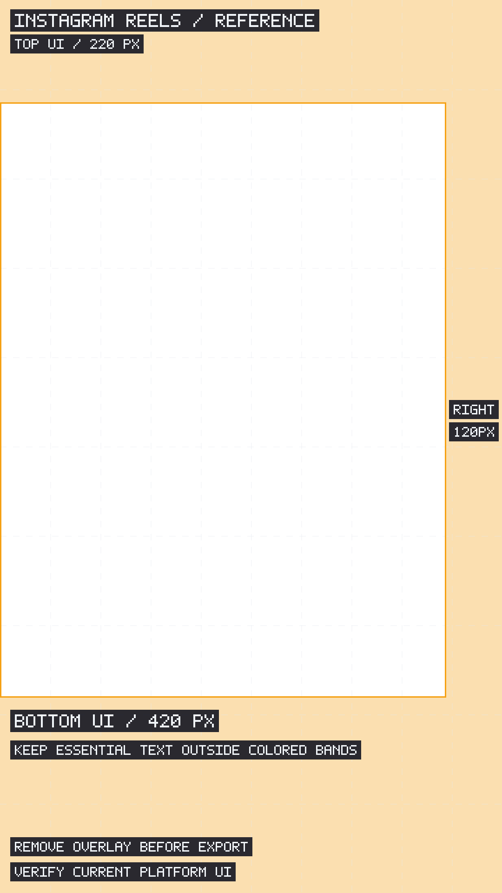
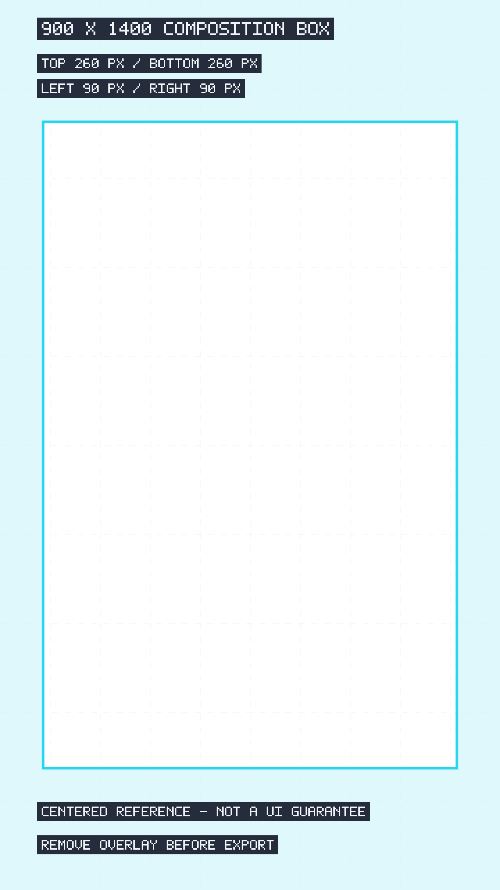

# 916 Vertical Video Safe Zone Templates & Transparent PNG Overlays

> **Live Interactive Previewer & AI Storyboard Builder:** 👉 [VelunaKit](https://velunakit.com)

Three full-resolution, transparent PNG overlays for editing 9:16 vertical video. Put an overlay above your footage, move essential captions and subjects away from the marked UI bands, then **hide or remove the overlay before exporting**.

No account, image-generation API, or paid asset download is needed. The included generator runs locally using Node.js built-ins only: no canvas package, native bindings, fonts, or network requests.

## Download the PNGs

- [TikTok 2026 reference overlay — 1080 × 1920](github-assets/tiktok-safe-zone-1080x1920.png)
- [Instagram Reels reference overlay — 1080 × 1920](github-assets/reels-safe-zone-1080x1920.png)
- [Centered 900 × 1400 composition box — on a 1080 × 1920 canvas](github-assets/universal-900x1400-safe-box.png)

Open an image link and use GitHub's **Download raw file** control, or download this repository as a ZIP from **Code → Download ZIP**. Do not save a reduced-size README thumbnail when you need the original pixels.

**All three files are 1080 × 1920 pixels, with square pixels and an 8-bit alpha channel.** The universal filename describes the inner box, not the PNG canvas size. There is no white background, black background, or checkerboard baked into these assets. Colored bands and dashed grid marks are intentionally translucent; labels are visible reference annotations.

## Preview

Click a thumbnail to open the original PNG. A GitHub preview may show transparency against a light or dark background; your footage remains visible beneath it in an editor.

<table>
<tr><th>TikTok</th><th>Instagram Reels</th><th>Centered composition</th></tr>
<tr>
<td align="center"><a href="github-assets/tiktok-safe-zone-1080x1920.png"></a><br>TikTok 2026</td>
<td align="center"><a href="github-assets/reels-safe-zone-1080x1920.png"></a><br>Instagram Reels</td>
<td align="center"><a href="github-assets/universal-900x1400-safe-box.png"></a><br>Centered composition box</td>
</tr>
</table>

## Exact geometry used by these templates

Coordinates start at the **top-left** of the 1080 × 1920 frame: X increases to the right, Y increases downward. All margins below are in source-image pixels, not CSS pixels or phone-screen pixels.

| Reference preset | Top | Right | Bottom | Left |
| --- | ---: | ---: | ---: | ---: |
| [TikTok 2026](github-assets/tiktok-safe-zone-1080x1920.png) | 130 | 140 | 350 | 44 |
| [Instagram Reels](github-assets/reels-safe-zone-1080x1920.png) | 220 | 120 | 420 | 0 |
| [Centered composition box](github-assets/universal-900x1400-safe-box.png) | 260 | 90 | 260 | 90 |

| Clear reference rectangle | X | Y | Width | Height |
| --- | ---: | ---: | ---: | ---: |
| TikTok 2026 | 44 | 130 | 896 | 1440 |
| Instagram Reels | 0 | 220 | 960 | 1280 |
| Centered composition box | 90 | 260 | 900 | 1400 |

These values mirror the existing presets in VelunaKit's Safe Zone Checker. The grid repeats every **108 px horizontally** and **192 px vertically**, or 10% of the frame. The outline marks the inside edge of each reference rectangle; line thickness is included inside the stated rectangle.

### Important: reference guides, not official guarantees

The name **TikTok 2026** is this project's preset label, not a claim that TikTok publishes or guarantees these exact fixed margins. Actual controls vary with device, region, app version, caption length, post type, shopping controls, and advertising add-ons. For paid placements, use the platform's current official template and placement preview.

The TikTok PNG is the project's standard profile, **not the Shop variant**. The interactive tool has a Shop option with a **484 px bottom margin**; that extra space is not represented in this download.

Despite its filename, the **900 × 1400 universal box is a centered composition aid, not the intersection of every platform's unobstructed area**. It extends into the right and bottom bands of the supplied TikTok and Reels profiles. Check essential text against the relevant platform overlay, even when the subject is inside the universal box. Neither this collection nor the previewer guarantees that a platform will never cover your content.

## Use in your video editor

Start with a **1080 × 1920, 9:16, square-pixel** timeline. Keep the overlay centered, uncropped, and at its original size. Import each PNG as an individual still image, not an image sequence. Extend its duration across the whole edit so later captions, camera moves, and end cards are checked too.

### CapCut

1. Create a 9:16 project and add your main footage.
2. Import the PNG. On desktop, put it on a track above the footage; on mobile, use **Overlay → Add overlay**.
3. Fit the complete PNG to the frame, retaining its aspect ratio. Do not zoom or crop the reference grid independently of the footage.
4. Move captions, product labels, and important facial details away from the colored UI bands. Inspect the opening hook, longest subtitle, and end card.
5. Hide or remove the overlay layer, then export a clean video. Do not burn the grid into the final upload.

### Adobe Premiere Pro

1. Create or open a 1080 × 1920 sequence. Put footage on **V1**.
2. Use **File → Import** for one PNG, with image-sequence import disabled. Put the still on **V2** or another track above all content being checked.
3. Center the PNG. In a matching 1080 × 1920 sequence, use **Scale 100%** and verify that its full frame aligns with the sequence.
4. Extend the still to the end of the sequence. Lock the reference track while you adjust captions and graphics below it.
5. Disable the reference track or remove its clip before export, and review the exported file without the overlay.

### DaVinci Resolve

1. Set the timeline resolution to **1080 × 1920** and put the footage on **Video 1**.
2. Import one PNG into the Media Pool as a still, then place it on **Video 2** above the footage.
3. Keep it centered at **Zoom 1.0** in a matching-resolution timeline. Check that project scaling has not cropped the overlay.
4. Extend the still over the entire edit and lock its track. Move essential text and graphics out of the marked regions.
5. Disable or remove the guide track before rendering on the Deliver page. Confirm the rendered video contains no grid or labels.

Editor labels can change between versions; the same principle applies everywhere: **full-frame transparent still on the highest video track, removed before delivery**.

## Troubleshooting

**The preview has a black or white background. Is the PNG opaque?**

A standalone image viewer may use a solid display background for transparent pixels. Put the PNG above actual footage to check its alpha channel. Do not use chroma key or erase a background; transparency is already present.

**The grid does not line up with the video edges.**

Check timeline resolution, aspect ratio, pixel aspect ratio, position, and scale. A stretched or cropped overlay invalidates its pixel margins. On a 2160 × 3840 timeline, scale the entire PNG uniformly by 200%; all reference margins double too.

**Can I use the universal box as a caption-safe guarantee?**

No. It helps center the composition, but some of it overlaps the platform-specific UI bands. Use the actual destination profile for text placement, and inspect the final post preview.

**Do these include TikTok Shop, every ad placement, or every language layout?**

No. This download contains exactly three reference overlays. For Shop, try the [interactive Safe Zone Checker](https://velunakit.com/safe-zone-checker). For paid placements and right-to-left layouts, consult the platform's current official safe-zone files.

## Rebuild and verify locally

Requires **Node.js 22 or newer**. No package installation is needed. Run from this repository's root:

```bash
node github-assets/generate-overlays.mjs
node github-assets/generate-overlays.mjs --check
```

The first command regenerates these three PNGs and this README. The check-only command does not rewrite files: it validates PNG chunk checksums, 1080 × 1920 RGBA headers, decoded pixel data, genuine transparency, and README consistency. Given the same Node.js/zlib version, repeated generation produces identical bytes; there are no timestamps or random pixels.

Edit the preset values and README text in **github-assets/generate-overlays.mjs**, then regenerate; manual README edits would be overwritten. This script does not edit or deploy the website.

## Continue the workflow

- [Preview your local image or video with platform masks](https://velunakit.com/safe-zone-checker).
- [Build a character-consistent AI storyboard and timed prompt](https://velunakit.com/).
- [Check voiceover word count and timing](https://velunakit.com/script-timer).
- [Read the PNG overlay workflow guide](https://velunakit.com/guides/export-1080x1920-transparent-png-grid).

## Official references

- [TikTok auction in-feed ad specifications and safe-zone files](https://ads.tiktok.com/resources/help/article/tiktok-auction-in-feed-ads?lang=en): placement and device previews can differ; these community reference pixels are not a substitute for official ad templates.
- [CapCut overlay workflow](https://www.capcut.com/resource/how-to-add-capcut-overlays).
- [Adobe Premiere: import still images and preserve transparency](https://helpx.adobe.com/premiere/desktop/organize-media/import-files/import-still-images.html).
- [Blackmagic Design: DaVinci Resolve training](https://www.blackmagicdesign.com/products/davinciresolve/training).

This independent community collection is not affiliated with or endorsed by TikTok, Meta, Adobe, CapCut, or Blackmagic Design. Platform and editor names identify compatibility; no official UI screenshots, logos, or proprietary template files are redistributed here.
